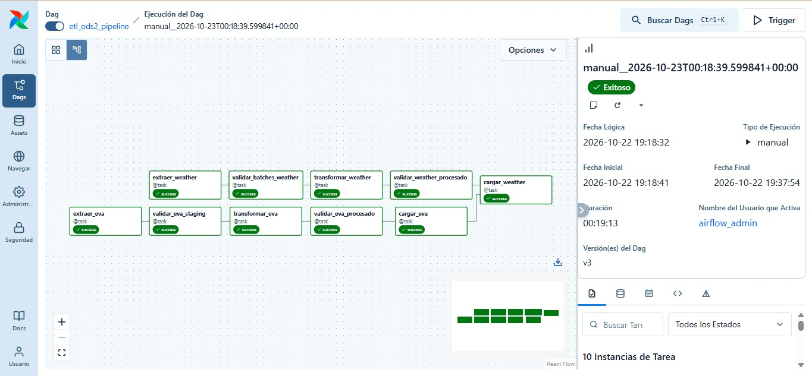
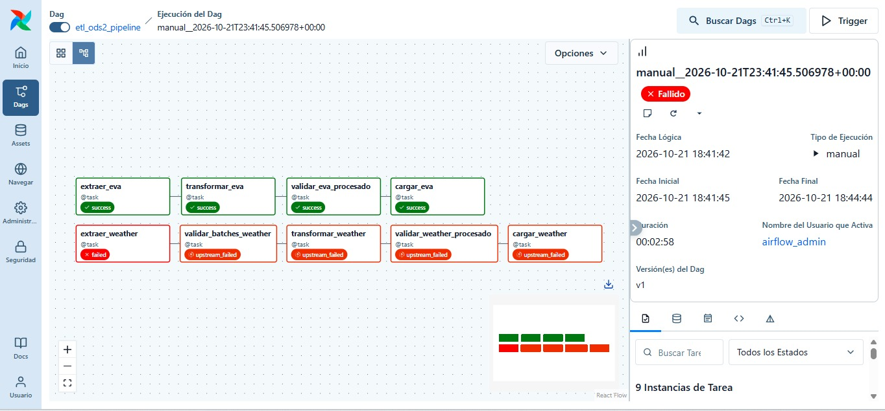
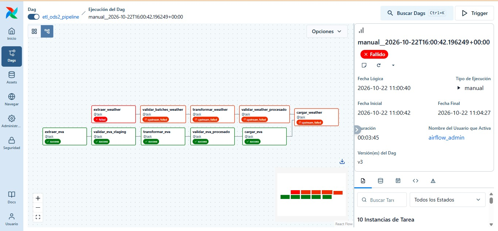
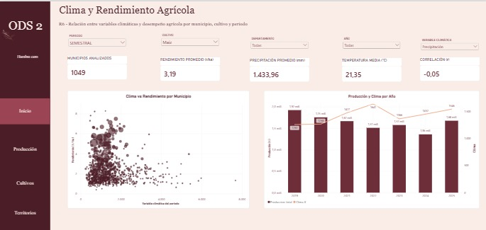
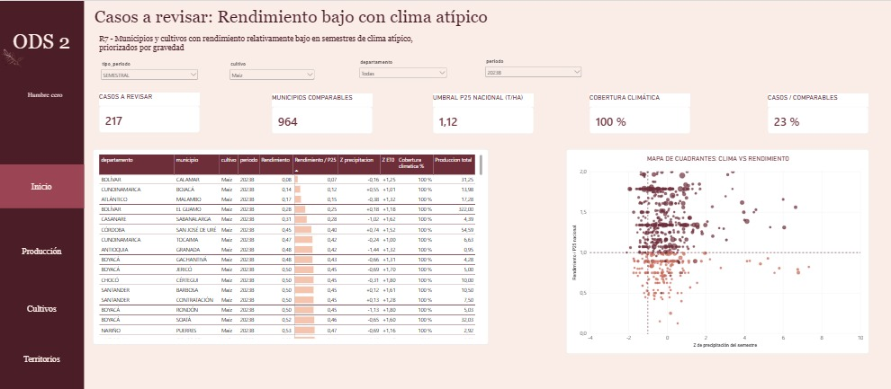

# 1. Project Context and Baseline

## 1.1. Problem and Analytical Objective

The territorial and temporal variability in the productive use of agricultural land across Colombian municipalities makes it difficult to identify gaps and opportunities for improving efficiency and strengthening food availability. This project originally focused on addressing these challenges by analyzing the Municipal Agricultural Evaluations (EVA) from 2019 to 2025 to identify productivity disparities among departments, municipalities, and crop types (Requirements R1–R5). This baseline directly supports decision-making aligned with Sustainable Development Goal 2: Zero Hunger.

  

Building on this foundation, the analytical objective has evolved to incorporate a critical environmental dimension (Requirements R6 and R7). By integrating the EVA dataset with historical meteorological indicators at the municipal level, the project now seeks to explore spatial-temporal patterns between agricultural performance and climate. The ultimate goal is to identify specific municipalities and crops that exhibit relatively low agricultural yields during periods of atypical climate conditions, such as reduced precipitation (water stress) or elevated evapotranspiration (thermal stress).

  

## 1.2. First Delivery Baseline

The first phase of the project established a fully functional, linear ETL pipeline and a dimensional Data Warehouse built on MySQL 8.0. The baseline infrastructure processed 166,732 agricultural records spanning 1,103 municipalities and 194 distinct crops.

  

Key achievements of the initial delivery include:

  

-   **Dimensional Model:** A Star Schema design featuring a central fact table (`fact_produccion_agricola`) and three dimension tables (`dim_geografia`,  `dim_cultivo`,  `dim_tiempo`).
    
      
    
-   **Analytical Scope:** Successful implementation of five core business requirements (R1–R5), enabling the comparison of agricultural yield (`rendimiento`) across territories, the analysis of land utilization efficiency (`area_sembrada` vs.  `area_cosechada`), and the structural evaluation of temporary versus permanent crop cycles.
    
      
    
-   **Data Quality Framework:** A validated staging process that preserves raw semantic phenomena (e.g., treating zero-value metrics as legitimate operational failures rather than missing data) and protects strict natural grain uniqueness (`codigo_municipio` + `codigo_cultivo` + `anio` + `periodo`).
    
      
    

## 1.3. Assumptions and Limitations

The analytical scope and subsequent interpretations are bound by specific methodological constraints and dataset characteristics:

  

**Limitations:**

  

-   **Methodological Structural Break (2022):** A significant change in the EVA reporting methodology occurred in 2022, primarily affecting temporary crops. This shift redefined area variables from sowing-oriented to harvest-oriented measurements, resulting in valid but anomalous records where harvested area exceeds planted area. Direct historical comparisons spanning the pre-2022 and post-2022 boundary must account for this reporting shift rather than attributing variances solely to physical agricultural changes.
    
      
    
-   **Absence of Exogenous Variables:** The dataset lacks external explanatory factors such as soil quality, localized infrastructure, fertilizer usage, and market conditions. Consequently, the integration of climate data highlights spatial-temporal associations and vulnerabilities, but does not establish strict, isolated causation for yield variations.
    
      
    
-   **Temporal Granularity:** The agricultural data is limited to annual and semiannual (A and B) reporting periods. It lacks daily or exact harvest-date tracking, restricting the ability to perform fine-grained, intra-semester seasonality analysis.
    
      
    

**Assumptions:**

  

-   **Identifier Stability:** DANE geographic codes (`codigo_municipio`) and crop codes (`codigo_cultivo`) are assumed to be stable, reliable business keys. They are processed strictly as text strings to prevent the loss of leading zeros.
    
      
    
-   **Temporal Independence:** Annual agricultural observations are treated as independent institutional reports rather than the mathematical sum of Semester A and Semester B. The ETL pipeline preserves them as distinct temporal entities.


# 2. Analytical Requirements

## 2.1. Status and Changes of Requirements R1-R5

The initial five analytical requirements (R1–R5) established the agricultural performance baseline and remain fully active and supported by the existing dimensional model. These requirements evaluate the temporal evolution of production (R1), regional productivity gaps across departments and municipalities (R2), land utilization efficiency (R3), strategic crop relevance (R4), and structural differences based on crop cycles and reporting periods (R5).

  

No structural changes were made to the business logic of R1–R5 during the current phase. Instead, they serve as the foundational comparative layer. By already having a validated framework to identify which territories and crops underperform, the project is now positioned to overlay external environmental factors to explore _under what conditions_ those performance drops occur.

  

## 2.2. New Integrated Requirements (R6 and R7)

To introduce the environmental dimension to the project, two new analytical requirements were integrated. These focus on aligning the agricultural outcomes with meteorological observations to detect patterns and historical anomalies.

  

**R6 — Climate and Agricultural Performance Analysis**

  

-   **Business Question:** How do agricultural production and yield vary in relation to observed climate conditions across Colombian municipalities and crops from 2019 to 2025?
    
      
    
-   **Analytical Objective:** Integrate agricultural production records with municipality-level climate indicators to explore temporal and geographical associations between crop performance and local weather conditions.
    
      
    
-   **Indicators:** Evaluates agricultural yield and production against mean temperature, accumulated precipitation, reference evapotranspiration (ET₀), and mean relative humidity.
    
      
    

**R7 — Municipality-Specific Climate Anomaly and Agricultural Performance Analysis**

  

-   **Business Question:** Which municipalities and crops exhibit relatively low agricultural yields during periods with unusually low precipitation or unusually high reference evapotranspiration, compared with each municipality's own historical climate conditions?
    
      
    
-   **Analytical Objective:** Identify municipality-crop-period combinations where agricultural yield is relatively low while local climate indicators depart significantly from the municipality's own historical baseline, utilizing comparable periods to account for seasonality.
    
      
    
-   **Indicators:** Evaluates yield against historical percentiles and deviations in accumulated precipitation, accumulated ET₀, and maximum/mean temperatures.
    
      
    

**Analytical Precaution:** The dashboard and data models present historical patterns and prioritize cases for further investigation. The observed associations between climate anomalies and yield reductions do not establish strict causality, as agricultural production is simultaneously influenced by technology, agricultural management, pests, and socioeconomic factors not captured in this dataset.


# 3. Data Sources

## 3.1. Primary Source and New API Source

The project integrates two structured data sources to perform its agroclimatic analysis:

  

-   **Primary Source (Agricultural):** The Municipal Agricultural Evaluations (EVA), provided by the Ministry of Agriculture and Rural Development (MADR) and the UPRA. The dataset is extracted from the Colombian Open Data Portal (`[https://www.datos.gov.co/Agricultura-y-Desarrollo-Rural/Evaluaciones-Agropecuarias-Municipales-EVA-2019-20/uejq-wxrr/about_data](https://www.datos.gov.co/Agricultura-y-Desarrollo-Rural/Evaluaciones-Agropecuarias-Municipales-EVA-2019-20/uejq-wxrr/about_data)`). It comprises 166,732 records spanning 1,103 municipalities between 2019 and 2025.
    
      
    
-   **New API Source (Climate):** Historical meteorological data is sourced from the Open-Meteo Archive API (`[https://archive-api.open-meteo.com/v1/archive](https://archive-api.open-meteo.com/v1/archive)`). This provides daily observations for six key variables: mean temperature, maximum temperature, minimum temperature, precipitation, relative humidity, and reference evapotranspiration (ET₀).
    
      
    

**API Extraction Strategy:** To handle API rate limits and ensure robust data retrieval, the extraction script utilizes a controlled batching and retry strategy instead of traditional pagination. Requests are processed in batches of 25 territories. The system allows up to 3 retries per request with a 180-second timeout, specifically configured to handle HTTP 429 (rate limit) and HTTP 5xx (server) errors. When a retriable error occurs, the script prioritizes the `Retry-After` header; if unavailable, it falls back to an exponential backoff sequence of 30, 60, and 120 seconds. A 5-second wait time is enforced between batches to reduce request frequency. Additionally, the system skips batches that have already been successfully downloaded and validated, optimizing the process and preventing redundant API calls.

  

## 3.2. Analytical Value Provided by the API

The integration of the Open-Meteo API elevates the project from a purely agricultural diagnostic tool into a comprehensive agroclimatic analytical platform. While the primary EVA dataset already enabled institutional stakeholders—such as the MADR, UPRA, and local Agricultural Secretariats—to identify territorial productivity gaps, the climate data adds a crucial environmental context.

  

By correlating yield fluctuations with weather data, stakeholders can now prioritize specific territories to investigate historical episodes of water stress (low precipitation) or thermal stress (high evapotranspiration and temperature). This analytical capability allows public entities to proactively direct technical assistance, allocate agricultural subsidies, and focus food security policies on the municipalities where crop productivity has proven most vulnerable to atypical climate conditions.

# 4. System Architecture

<iframe width="100%" height="500px" style="box-shadow: 0 2px 8px 0 rgba(63,69,81,0.16); border-radius:15px;" allowtransparency="true" allowfullscreen="true" scrolling="no" title="Embedded DrawSQL IFrame" frameborder="0" src="https://drawsql.app/teams/fergie-montero/diagrams/delivery2/embed"></iframe>

The project utilizes a modern analytical data architecture structured into four primary layers that manage the data flow from extraction to final consumption. The workflow is orchestrated using Apache Airflow, ensuring sequential execution and dependency validation between tasks.

### 4.1. Data Source Layer

The system ingests data from two distinct sources:

-   **Static Source (Agricultural):** A flat CSV file containing historical Municipal Agricultural Evaluations (EVA) records, stored locally or in a data lake.
    
-   **Dynamic Source (Open-Meteo API):** Automated extraction via a Python script that executes batched HTTP requests (25 territories per batch). The system handles API rate limits and server errors (HTTP 429 and 5xx) through an exponential backoff strategy of 30, 60, and 120 seconds.
    

### 4.2. Processing & ETL Layer

This layer handles data validation and transformation through a hybrid processing model:

-   **In-Memory Processing (Pandas):** Python and Pandas are used to read, validate, and consolidate the daily weather batches, as well as to apply quality rules (e.g., preserving leading zeros in DANE geographic codes as strings).
    
-   **In-Database Transformation (SQL):** The aggregation of daily climate variables into agricultural periodicities (annual/semester) is delegated to the database engine via SQL statements, leveraging native aggregation functions over the time dimensions.
    

### 4.3. Storage Layer & Data Warehouse

Structured and transformed data is stored in a relational database (MySQL) designed under a dimensional Star Schema model. This schema integrates agricultural and climate data through shared dimensions:

-   **Dimension Tables:** `dim_geografia`, `dim_cultivo`, `dim_tiempo`, and `dim_fecha`. These tables utilize auto-incrementing surrogate primary keys (`sk_geografia`, `sk_cultivo`, `sk_tiempo`, `sk_fecha`) and `UNIQUE` constraints to protect business identifiers.
    
-   **Fact Tables:**
    
    -   `fact_produccion_agricola`: Stores agricultural measures including planted area, harvested area, production, and yield.
        
    -   `fact_clima_diario`: Captures daily meteorological details and includes extraction lineage tracking via `source_batch_id`.
        
    -   `fact_clima_periodo`: Contains climate aggregates per period (temperatures, precipitation, ET₀) alongside critical quality metrics such as expected days, observed days, and percentage coverage (`cobertura_porcentual`).
        

Strict referential integrity is enforced between fact and dimension tables using `FOREIGN KEY` constraints.

### 4.4. Consumption Layer

The final layer is powered by **Microsoft Power BI**, which connects directly to the MySQL Star Schema. Power BI imports the dimensional model to process analytical measures (DAX) and render the interactive agroclimatic dashboard for end-users and institutional stakeholders.


## Section 5: Data Profiling and Quality Rules

### 5.1 Data Profiling Findings

Data profiling was conducted across both the existing agricultural baseline and the newly extracted climate batches to ensure structural integrity prior to integration.

* **Agricultural Source (EVA):** The dataset contains 166,732 observations across 1,103 municipalities. Profiling confirmed 0 null values and 0 exact row duplicates. A known semantic anomaly exists where harvested area exceeds planted area for temporary crops starting in 2022, which is preserved as a valid methodological shift.
* **Climate Source (Open-Meteo):** Initial profiling covered completed extraction batches (`weather_batch_001.csv` through `weather_batch_007.csv`).
* **Climate Completeness:** Tested batches showed 0 null values across all six core meteorological variables (mean, maximum, and minimum temperature, precipitation, relative humidity, and reference evapotranspiration $\text{ET}_0$).
* **Physical Validity (Climate):** Variable boundaries were strictly validated against physical laws. Profiling confirmed 0 negative values for precipitation and $\text{ET}_0$, 0 humidity values outside the 0–100% range, and perfect internal consistency for temperatures ($\text{Minimum} \le \text{Mean} \le \text{Maximum}$). Geographic coordinates (latitude/longitude) were correctly bounded.
* **Granularity and Uniqueness:** No duplicate municipality-date keys were found in the profiled climate batches. However, a direct join between agricultural data (municipality-crop-period grain) and climate data (municipality-date grain) would replicate agricultural measures across days, necessitating explicit temporal alignment and aggregation.

### 5.2 Risks and Explicit Quality Rules

To mitigate integration risks, explicit data quality (DQ) rules were defined with associated severity levels (Critical, High, Warning, Informative) to govern the ETL pipeline.

#### Identified Integration Risks
* **RSK-05 (Extraction Incompleteness):** Missing municipalities or dates in the API extraction could lead to biased climate coverage and inaccurate averages.
* **RSK-06 (Duplication):** Duplicate municipality-date keys in staging could result in the double-counting of accumulated precipitation and evapotranspiration.
* **RSK-09 & RSK-10 (Temporal Incompatibility):** Joining daily climate observations directly to EVA periods without proper aggregation would artificially multiply agricultural rows and inflate production measures.
* **RSK-12 (Opaque Coverage):** Calculating period aggregates without tracking the underlying valid daily observations could lead to misinterpretation if a significant portion of the period is missing data.

#### Core Data Quality Rules

| Rule ID | Layer / Domain | Quality Rule Description | Threshold / Acceptance Criteria | Severity |
| :--- | :--- | :--- | :--- | :--- |
| **DQ-API-01** | Open-Meteo Staging | Uniqueness of daily observations. | 0 duplicate municipality-date keys. | Critical |
| **DQ-API-02** | Open-Meteo Staging | Temporal completeness per municipality. | 2,557 unique dates per municipality for the full 2019–2025 interval. | Critical (full load) / Warning (batch load) |
| **DQ-API-05** | Open-Meteo Staging | Physical validity of precipitation and $\text{ET}_0$. | 0 negative values. | Warning (investigate before accepting) |
| **DQ-API-07** | Open-Meteo Staging | Missing values handling. | 0 nulls silently imputed as zeros. | Warning / Critical |
| **DQ-API-08** | Open-Meteo Staging | Extraction lineage and traceability. | 100% of records must contain a valid `source_batch_id`. | Critical |
| **INT-003** | Integration | Period coverage tracking. | Record expected days, observed days, valid days per variable, and percentage coverage. | High |
| **INT-008** | Integration | Temporal consistency of overlapping periods. | Annual periods must be aggregated from daily data, not by summing Semester A and Semester B aggregates. | High |

  

# 6. Automated Validation (Great Expectations)

## 6.1. Base Design and Rule Traceability

The project utilizes Great Expectations (GE) as the primary automated data quality framework to enforce structure, completeness, data types, and value ranges. To ensure comprehensive coverage of the project's quality requirements, GE is complemented by custom Python and SQL validations that handle complex business rules and specific temporal coverage metrics not natively supported by standard expectations.
Key data quality rules from the integration contract are mapped directly to GE Expectations, including:

-   **Schema Conformity:**  `expect_table_columns_to_match_set` ensures all required attributes are present.
    
      
    
-   **Completeness:**  `expect_column_values_to_not_be_null` prevents silent missing values in critical metrics.
    
      
    
-   **Data Types:**  `expect_column_values_to_be_of_type` enforces strict type casting before database ingestion.
    
      
    
-   **Physical Bounds:**  `expect_column_values_to_be_between` guarantees that meteorological variables fall within valid scientific ranges (e.g., relative humidity restricted between 0 and 100).
    
      
    
-   **Granularity Protection:** Uniqueness expectations applied to the combination of municipality and date keys prevent duplicate records and double-counting.
    
      
    
-   **Temporal Boundaries:** Date and time coverage validations ensure all records strictly belong to the 2019–2025 analysis period.
    
      
    

## 6.2. Raw Data Validation

The raw data validation suite is executed against the individual API extraction batches prior to consolidation. This stage acts as an early quality gate, focusing on base-level integrity. It verifies that the incoming schema is correct, data types match expectations, and all numerical values are finite. Additionally, it checks the validity of geographic identifiers (municipality codes and coordinates) and confirms initial date formatting and temporal coverage.

  

## 6.3. Prepared Data Validation
After the transformation and consolidation of the 45 API extraction batches, the prepared dataset (`weather_processed.csv`) undergoes a rigorous final validation pass.
This validation is executed programmatically via `src/validation/validate_weather_processed.py`. The process evaluates the consolidated CSV against the Prepared Data suite, generating a structured JSON report alongside temporary GE Data Docs. Baseline testing of the consolidated climate dataset completed successfully, returning an "APPROVED" validation status with an exit code of 0.
**Pipeline Orchestration Integration:** These validation scripts are designed to function as strict quality gates within the ETL architecture. They are structured to be integrated as discrete tasks within the Apache Airflow DAG. Under this design, a failed validation will immediately block the pipeline, preventing compromised or non-compliant data from advancing to the Data Warehouse layer.


# 7. Transformation, Integration, and Modeling

## 7.1. Transformation Strategy and Integration Contract

Integrating the agricultural production data (EVA) with the meteorological data (Open-Meteo) requires a strict transformation strategy to align sources with fundamentally different granularities. The integration contract relies on two primary pillars:

-   **Spatial Alignment:** Both sources are integrated at the municipal level using the official 5-character DANE municipality code (`codigo_municipio`). During transformation, this code is strictly cast and preserved as a string (`VARCHAR`) to prevent the truncation of leading zeros, ensuring a perfect match between the climate and agricultural records.
    
-   **Temporal Alignment and Aggregation:** The agricultural data is recorded in specific evaluation periods (Annual, Semester A, Semester B), while the climate data provides daily observations. A direct join between these datasets would artificially multiply the agricultural metrics across days. To solve this, the transformation strategy is executed in two phases:
    
    1.  **In-Memory Processing (Pandas):** The raw daily weather batches are cleaned, validated, and consolidated into a unified daily dataset using Pandas.
        
    2.  **In-Database Aggregation (SQL):** The daily climate observations are aggregated to match the exact start and end dates of the EVA periods using SQL. Precipitation and reference evapotranspiration (ET₀) are accumulated (sums), while temperatures and relative humidity are averaged.
        

To guarantee the analytical validity of these aggregates, the integration contract mandates tracking climate coverage. The pipeline calculates and stores the expected days, observed days, valid days per variable, and percentage coverage (`cobertura_porcentual`) for every municipality-period combination. This ensures that climate indicators are only trusted if the underlying daily data is sufficiently complete.

## 7.2. Refined Dimensional Model

The Data Warehouse implements a refined Star Schema designed to support parallel analysis of agricultural and climatic facts without causing data duplication or Cartesian products. The model utilizes conformed (shared) dimensions to bridge the different fact tables.

**Dimension Tables:**

-   `dim_geografia`: Stores the territorial hierarchy (Department → Municipality), acting as the spatial bridge between agriculture and climate.
    
-   `dim_tiempo`: Defines the EVA reporting periods (Annual, Semester A, Semester B) and includes explicit start and end dates (`fecha_inicio`,  `fecha_fin`) to bound the climate aggregations.
    
-   `dim_cultivo`: Stores the agricultural classification hierarchy (Crop Group → Subgroup → Crop → Disaggregation) and crop cycle.
    
-   `dim_fecha`: A standard daily calendar dimension used exclusively to navigate the daily climate records.
    

**Fact Tables:** The architecture separates facts based on their natural grain, avoiding direct fact-to-fact joins:

1.  **`fact_produccion_agricola`:**
    
    -   _Grain:_ Municipality + Crop + EVA Period.
        
    -   _Measures:_ Planted area, harvested area, production, and yield.
        
2.  **`fact_clima_diario`:**
    
    -   _Grain:_ Municipality + Calendar Date.
        
    -   _Measures:_ Daily mean, maximum, and minimum temperatures, daily precipitation, relative humidity, ET₀, and extraction batch lineage (`source_batch_id`).
        
3.  **`fact_clima_periodo`:**
    
    -   _Grain:_ Municipality + EVA Period.
        
    -   _Measures:_ Period-aggregated climate metrics (e.g.,  `precipitacion_acumulada`,  `temperatura_media_periodo`) alongside the strict coverage tracking metrics (`dias_esperados`,  `dias_observados`,  `cobertura_porcentual`).
        

By linking `fact_produccion_agricola` and `fact_clima_periodo` exclusively through the shared `dim_geografia` and `dim_tiempo` dimensions, the BI layer can seamlessly evaluate agricultural yield against climate anomalies at the exact same spatial-temporal level.

# 8. Data Warehouse: Implementation and Loading

## 8.1. Database Technology and Schemas

The Data Warehouse is implemented on PostgreSQL, utilizing the `psycopg2` Python driver for direct database operations. To maintain structural organization and domain separation, the database utilizes dedicated schemas: a `comun` schema for shared dimensions (such as geography) and a `weather` schema for climate-specific dimensions and fact tables.

  

## 8.2. Script Ecosystem

The extraction, transformation, validation, and loading of the climate data are managed by a distinct set of Python modules:

  

-   `open_meteo.py`: Manages the batched API extraction from Open-Meteo.
    
      
    
-   `src/transformation/transform_weather.py`: Handles in-memory Pandas transformation and consolidation of extraction batches into `weather_processed.csv`.
    
      
    
-   `src/validation/validate_weather_processed.py`: Executes automated Great Expectations validation on the prepared dataset.
    
      
    
-   `src/load/load_weather.py`: Orchestrates surrogate key resolution and loads the daily climate facts into PostgreSQL.
    
      
    
-   `[TODO: Insert Airflow DAG script name]`: Orchestrates the execution dependencies of the pipeline tasks.
    
      
    

## 8.3. Surrogate Key Mapping

Surrogate key resolution is executed in-memory using Python dictionaries to ensure fast, bulk-insert compatibility. The `load_weather.py` script builds two primary lookups before loading the fact table:

  

1.  **Geography (`sk_geografia`):** Fetched from `comun.dim_geografia` using the `codigo_municipio`. To enforce strict referential integrity, the pipeline raises an explicit error if a municipality code from the weather dataset is missing in the geographic dimension, halting the load rather than processing partial or orphaned records.
    
      
    
2.  **Date (`sk_fecha`):** The script first populates or updates `weather.dim_fecha` with any missing dates, then retrieves the mappings to build a lookup associating the calendar date with its corresponding `sk_fecha`.
    
      
    

## 8.4. Loading Daily Facts

The daily climate observations are loaded using `psycopg2`'s `execute_values` method for optimized bulk ingestion. The script reads the validated `weather_processed.csv` and processes it in batches of 5,000 records (`BATCH_SIZE = 5000`), executing the inserts using internal page sizes of 1,000 records (`page_size=1000`).

  

To ensure pipeline idempotency and prevent data duplication during reruns or batch updates, the ingestion query utilizes an upsert strategy:  `ON CONFLICT (sk_geografia, sk_fecha) DO UPDATE`. This guarantees that if a daily record for a specific municipality and date already exists, its meteorological values are updated without violating the table's unique granularity constraints.

  

## 8.5. In-Database Aggregation (Period Alignment)

To align the daily weather metrics with the EVA agricultural reporting periods, the data is aggregated using native SQL functions (`AVG`,  `MAX`,  `SUM`) along with counts of observed days to calculate exact percentage coverage.

`[TODO: Specify the exact execution mechanism for this aggregation—e.g., whether it is triggered via a specific .sql script, implemented as a materialized view, or executed directly from Python via psycopg2. Additionally, confirm if the target aggregated data is physically stored in a dedicated 'fact_clima_periodo' table or queried dynamically for the BI layer]`.


## 9.1. DAG Design and Task Interfaces

The end-to-end data pipeline is orchestrated using Apache Airflow through a dedicated DAG named `dag_weather_open_meteo`. The DAG is designed as a strict, linear pipeline ensuring that downstream tasks only execute if their predecessors complete successfully and pass all quality gates.

The pipeline consists of five sequential tasks:

1.  **`extraer_weather`:** Extracts raw meteorological data from the Open-Meteo API in batches.
    
2.  **`validar_batches_weather`:** Validates the raw extracted batches (`src/validation/validate_weather_batches.py`) to catch schema or connection anomalies early.
    
3.  **`transformar_weather`:** Consolidates and transforms the validated raw batches into a single structured dataset.
    
4.  **`validar_weather_procesado`:** Executes Great Expectations against the prepared dataset (`src/validation/validate_weather_processed.py`). It outputs a JSON validation report (e.g.,  `weather_processed_validation_<timestamp>.json`).
    
5.  **`cargar_weather`:** Loads the validated, processed data into the PostgreSQL Data Warehouse.
    

Task execution is handled by invoking the respective Python scripts via `subprocess.run()` with the `check=True` parameter. This interface guarantees that any non-zero exit code returned by a script—such as a Great Expectations validation failure—immediately raises an exception within the Airflow task.

## 9.2. Failure and Retry Policies

The pipeline enforces a hard-stop failure policy at the task level. Because tasks are chained with explicit dependencies, a failure in any quality gate (such as `validar_weather_procesado` returning an unapproved status) automatically blocks the execution of subsequent tasks, protecting the Data Warehouse from compromised data.

At the DAG configuration level, the orchestration retry policy is defined as follows:`[TODO: Insert Airflow default_args details here, e.g., "The DAG is configured with 3 retries per task, utilizing a 5-minute retry delay for transient failures before permanently failing the pipeline run."]`

# 10. Reliability Testing and Evidence

### 10.1 Test A: Successful Execution 

**Objective:** Demonstrate that the complete ETL pipeline, including parallelizable agricultural and climate data branches, can execute from start to finish without errors. 
**Scenario and Execution:** A manual run of the `etl_ods2_pipeline` DAG (version v3) was triggered by the administrator (`airflow_admin`). 

**Complete Execution:** All 10 task instances of the DAG completed successfully, and the overall run state was marked as "Success" (green). The total process duration was 19 minutes and 13 seconds (00:19:13). * 
**Successful Quality Validation:** Tasks corresponding to quality gates—such as `validar_batches_weather`, `validar_weather_procesado`, `validar_eva_staging`, and `validar_eva_procesado`—executed with a `success` status. This confirms that raw and transformed data met all Great Expectations suites and business rules, enabling the flow to advance. * 

**Effective Loading:** The final insertion tasks (`cargar_weather` and `cargar_eva`) finished correctly (green), confirming successful writing to the Data Warehouse. 

**Conclusion:** The system is fully stable and functional. The DAG design correctly orchestrates the extraction, transformation, validation, and simultaneous loading of multiple sources into PostgreSQL without interruptions.

## 10.2. Test B: Controlled Critical Failure


**Objective:** Demonstrate pipeline resilience, dependency enforcement, and branch isolation when a critical extraction task fails.

**Scenario and Execution:** During this test, the pipeline encountered a critical failure at the very beginning of the climate data workflow. The `extraer_weather` task failed to complete successfully (e.g., due to API unreachability or exceeding maximum retry limits).

**Observed Behavior (Based on Airflow Evidence):**

-   **Circuit Breaker Activation:** The `extraer_weather` task was explicitly marked as `failed` (red). Because the DAG enforces strict linear dependencies, Airflow immediately halted the rest of the climate branch. All downstream tasks (`validar_batches_weather`, `transformar_weather`, `validar_weather_procesado`, and `cargar_weather`) were correctly blocked and marked as `upstream_failed` (orange).
    
-   **Branch Isolation:** Despite the critical failure in the weather extraction, the parallel agricultural branch remained completely unaffected. Tasks such as `extraer_eva`, `validar_eva_staging`, and subsequent EVA tasks executed normally and achieved a `success` state (green).

### 10.2 Test C: Repeatability and Safe Rerun

 **Objective:** Validate pipeline idempotency, ensuring that reruns (e.g., after resolving an API outage) do not generate duplicate records or violate Data Warehouse integrity. 
 **Scenario and Execution:** Following a prior failed execution (documented in Test B), the pipeline was manually re-triggered over the exact same datasets. 
 
 **Conflict-Free Execution:** Even though the pipeline processed the same batches, the final loading tasks (`cargar_weather` and `cargar_eva`) terminated with a `success` status without throwing database errors. * 

**Idempotency in Action:** The success of this execution demonstrates that the loading strategy configured in PostgreSQL (using `ON CONFLICT DO UPDATE`) operated correctly. The system updated existing records instead of attempting to duplicate them or failing due to unique constraint violations (`UNIQUE constraint`).


# 11. Analytical Product and Traceability

The analytical product is a Power BI dashboard connected to the PostgreSQL 16 Data Warehouse (`ods2_dw`). It answers requirements **R6** (climate vs. agricultural performance) and **R7** (low yield under atypical climate), and it is the visible proof that the Open-Meteo API source adds value on top of the EVA dataset. All figures are read from the DW (schemas `comun`, `eva`, `weather`); no CSV, raw or intermediate file is used by the dashboard.

## 11.1. Dashboard and Visualizations


### Connection and data model

- **Connection:** Power BI Desktop, PostgreSQL connector, Import mode, database `ods2_dw`.
- **Star schema loaded in full:** two fact tables sharing conformed dimensions.
  - Facts: `eva.fact_produccion_agricola` (grain: municipality, crop, period) and `fact_clima_periodo`, a native SQL query over `weather.fact_clima_diario`, `weather.dim_fecha` and `eva.dim_tiempo` that aggregates daily climate to the EVA period (grain: municipality, period).
  - Dimensions: `comun.dim_geografia`, `eva.dim_cultivo`, `eva.dim_tiempo`.
- **Daily-to-period aggregation:** precipitation and ET0 are summed over the period; mean temperature, maximum temperature and relative humidity are averaged. The query also returns `dias_con_dato` and `dias_periodo`, which feed the climate coverage indicator.
- **Rule applied everywhere:** annual and semester rows coexist in `dim_tiempo`, so every page filters `tipo_periodo`. Yield is always computed as total production divided by total harvested area, never as an average of row-level yields.

### Page R6: Climate and agricultural performance

Unit of analysis: municipality–crop–period (annual or semester). Default view for the presentation: Semester, Maize, all departments, all years, climate variable = Precipitation.

| Element | Type | Definition and unit | DW source |
|---|---|---|---|
| Period, Crop, Department, Year | Slicers | Filter by `tipo_periodo`, crop, department and year | `dim_tiempo`, `dim_cultivo`, `dim_geografia` |
| Climate variable | Slicer (selector table) | Chooses the climate variable used on the X axis, the line and the correlation: precipitation, mean temperature, ET0 or relative humidity | Measure `Clima X` (SWITCH over climate measures) |
| Analyzed municipalities | KPI | Municipalities with a computable yield in the selection | `fact_produccion_agricola`, `dim_geografia` |
| Average yield (t/ha) | KPI | Total production / total harvested area | `fact_produccion_agricola.produccion`, `area_cosechada` |
| Average precipitation (mm) | KPI | Precipitation accumulated over the period (sum of daily values), averaged across municipality–period combinations | `fact_clima_periodo.precipitacion_total_mm` |
| Mean temperature (°C) | KPI | Average of daily mean temperature over the period | `fact_clima_periodo.temperatura_media_c` |
| Correlation (r) | KPI | Pearson correlation between the selected climate variable and yield across municipalities (−1 to +1); descriptive only | Measure `Correlacion clima rendimiento` |
| Climate vs. yield by municipality | Scatter plot | X: selected climate variable; Y: yield (t/ha); bubble size: production (t); one point per municipality | Facts + `dim_geografia` |
| Production and climate by year | Combo chart | Columns: total production (t); line: selected climate variable; X: year | `fact_produccion_agricola`, `fact_clima_periodo`, `dim_tiempo.anio` |

### Page R7: Cases to review (low yield under atypical climate)

Mainly semester-level, as required, with annual context available through the period filter.

**Measurable criteria** (a municipality–crop–semester is flagged when all three hold):

1. **Low yield:** yield is not blank and is at or below the national 25th percentile (P25) of the same crop and semester, with at least 10 comparable municipalities.
2. **Atypical climate:** semester precipitation z-score ≤ −1 or semester ET0 z-score ≥ +1. Each z-score compares the semester with the same municipality's own history for the same semester (A or B) in 2019–2025.
3. **Sufficient climate coverage:** valid daily records ≥ 95 % of the days in the period.

| Element | Type | Definition and unit | DW source |
|---|---|---|---|
| Period, Crop, Department, Semester | Slicers | Single-semester selection (z-scores are computed per semester) | `dim_tiempo`, `dim_cultivo`, `dim_geografia` |
| Cases to review | KPI | Number of flagged municipality–crop–semester cases | Measure `Caso a revisar` summed over the selection |
| Comparable municipalities | KPI | Municipalities with a yield in the selected crop and semester (the percentile base) | `fact_produccion_agricola` |
| National P25 threshold (t/ha) | KPI | 25th percentile of municipal yield | Measure `Rendimiento P25 nacional` |
| Climate coverage | KPI | Valid climate days / days in the period | `fact_clima_periodo.dias_con_dato`, `dias_periodo` |
| Cases / comparable | KPI | Flagged cases as a share of comparable municipalities | Measures `Casos sobre comparables` |
| Prioritized case list | Table | Cases sorted by yield relative to P25 (lowest first), with yield, production, precipitation z, ET0 z and coverage | Facts + dimensions |
| Quadrant map | Scatter plot | X: precipitation z-score; Y: yield / national P25; dashed lines at x = −1 and y = 1; flagged cases highlighted | Measures `Z precipitacion`, `Rend relativo a P25` |

The dashboard flags cases for review. It does **not** label them as drought or water stress, because low precipitation or high ET0 alone is not enough to make that claim.

### Methodological notes and known limitations

- **Climate source:** Open-Meteo Historical Weather API, based on ERA5/ERA5-Land reanalysis (a model, not weather-station data; cells of about 25 km). It can over- or under-estimate precipitation in mountainous terrain. Example: Pradera (Valle del Cauca) shows about 15,000 mm of annual precipitation, with correct coordinates and complete daily series; the value is kept and disclosed.
- **Correlation is not causation.** Results are descriptive associations at municipality level; other factors (altitude, soils, technology, irrigation) are not measured.
- **Daily boundaries:** days are defined in UTC, as requested from the API.
- **Permanent crops** (for example coffee) only have annual periods in the EVA, so they do not appear in semester views.
- **Climate has no crop dimension:** climate is attached to municipality and period, so analyses are always conditioned on the crop that has production in that municipality.

## 11.2. End-to-End Traceability Matrix

### Pipeline traceability (source to dashboard)

| Stage | EVA branch | Weather (Open-Meteo) branch |
|---|---|---|
| Source | EVA agricultural evaluations (municipal crop data) | Open-Meteo Historical Weather API (`archive-api.open-meteo.com/v1/archive`), daily variables 2019-01-01 to 2025-12-31 |
| Extraction | `src/extraction/eva.py` | `src/extraction/open_meteo.py` (45 batches of 25 coordinates, retries with backoff) |
| Raw validation | `src/validation/validate_eva.py` | `src/validation/validate_weather_batches.py` |
| Transformation | `src/transformation/transformacion_eva.py` | `src/transformation/transform_weather.py` (batch consolidation, date and numeric normalization) |
| Processed validation | `src/validation/validate_eva_processed.py` (Great Expectations) | `src/validation/validate_weather_processed.py` (checks WX-POST-01 to WX-POST-13) |
| Load | `src/load/load_eva.py` → `comun.dim_geografia`, `eva.dim_cultivo`, `eva.dim_tiempo`, `eva.fact_produccion_agricola` | `src/load/load_weather.py` → `weather.dim_fecha`, `weather.fact_clima_diario` |
| Orchestration | Airflow DAG `etl_ods2_pipeline` (the weather load runs after the EVA load because it depends on the shared geography dimension) | |
| Consumption | Power BI, Import mode, star schema over the DW | |

### Requirement traceability

| Requirement | Question answered | Indicators | Climate variables | DW elements | Dashboard elements |
|---|---|---|---|---|---|
| **R6** | How do climate and agricultural performance relate by municipality–crop–period? | Production, yield, harvested area | Mean temperature, precipitation, ET0, relative humidity | `fact_produccion_agricola`, `fact_clima_periodo` (from `weather.fact_clima_diario`), `dim_geografia`, `dim_cultivo`, `dim_tiempo` | R6 page: KPIs, climate-vs-yield scatter, production-and-climate combo, climate variable selector |
| **R7** | Which municipalities and crops show relatively low yield during atypical climate, prioritized? | Yield relative to the national P25 | Precipitation z-score, ET0 z-score, climate coverage | Same facts and dimensions; `dias_con_dato` and `dias_periodo` for coverage | R7 page: KPIs, prioritized case table, quadrant map |

### Visual-level traceability

| Visual / KPI | Requirement | DW element or query |
|---|---|---|
| Analyzed municipalities | R6 | `eva.fact_produccion_agricola`, `comun.dim_geografia` |
| Average yield | R6 | `eva.fact_produccion_agricola` (production / harvested area) |
| Average precipitation | R6 | `weather.fact_clima_diario.precipitacion` via `fact_clima_periodo` |
| Mean temperature | R6 | `weather.fact_clima_diario.temperatura_media` via `fact_clima_periodo` |
| Correlation (r) | R6 | `fact_produccion_agricola` + `fact_clima_periodo` |
| Climate vs. yield scatter | R6 | Both facts + `dim_geografia`, `dim_tiempo`, `dim_cultivo` |
| Production and climate by year | R6 | Both facts + `dim_tiempo.anio` |
| Cases to review, Cases / comparable | R7 | `Caso a revisar` over both facts |
| Comparable municipalities, National P25 | R7 | `eva.fact_produccion_agricola` |
| Climate coverage | R7 | `fact_clima_periodo.dias_con_dato`, `dias_periodo` |
| Prioritized case table | R7 | Both facts + dimensions |
| Quadrant map | R7 | `Z precipitacion`, `Rend relativo a P25` |

**Value of the API source:** every R6 and R7 visual combines EVA production with Open-Meteo climate through the conformed dimensions `dim_geografia` and `dim_tiempo`; without the weather branch, none of these visuals could be built.


```
## 12. Deployment and Administration

### 12.1 Configuration and Execution Instructions

To configure, deploy, and execute the project's ETL pipeline and Data Warehouse, follow the detailed instructions below:

#### System Prerequisites
* **Python 3.9 or higher** (with pip)
* **PostgreSQL** (compatible with `comun` and `weather` schemas)
* **Apache Airflow** (for orchestrating the `dag_weather_open_meteo` DAG)
* **Power BI Desktop** (for visualizing and consuming the dashboard)

#### 1. Clone the Repository and Set Up the Environment
1. Clone the repository and navigate to the project root:
   ```bash
   git clone <repository-url>
   cd <repository-directory>

```

2.  Create and activate a Python virtual environment:
    
    
    ```
    python -m venv venv
    # On Windows:
    venv\Scripts\activate
    # On macOS/Linux:
    source venv/bin/activate
    
    ```
    
3.  Install the required dependencies:
  
    
    ```
    pip install -r requirements.txt
    
    ```
    

#### 2. Credential Configuration

Configure the environment variables required for PostgreSQL database connectivity and execution parameters:


```
export DB_HOST="localhost"
export DB_PORT="5432"
export DB_NAME="dw_eva_agricola"
export DB_USER="postgres"
export DB_PASSWORD="your_password"

```

#### 3. Execution of Extraction, Validation, and Loading

The workflow can be executed automatically via the Apache Airflow DAG (`dag_weather_open_meteo`) or manually using individual scripts in the corresponding order:

1.  **Meteorological data extraction and transformation:**
    
    
    ```
    python open_meteo.py
    python src/transformation/transform_weather.py
    
    ```
    
2.  **Automated validation (Great Expectations):**
    
 
    ```
    python src/validation/validate_weather_batches.py
    python src/validation/validate_weather_processed.py
    
    ```
    
3.  **Loading to the Data Warehouse (PostgreSQL):**
    
 
    
    ```
    python src/load/load_weather.py
    ```
